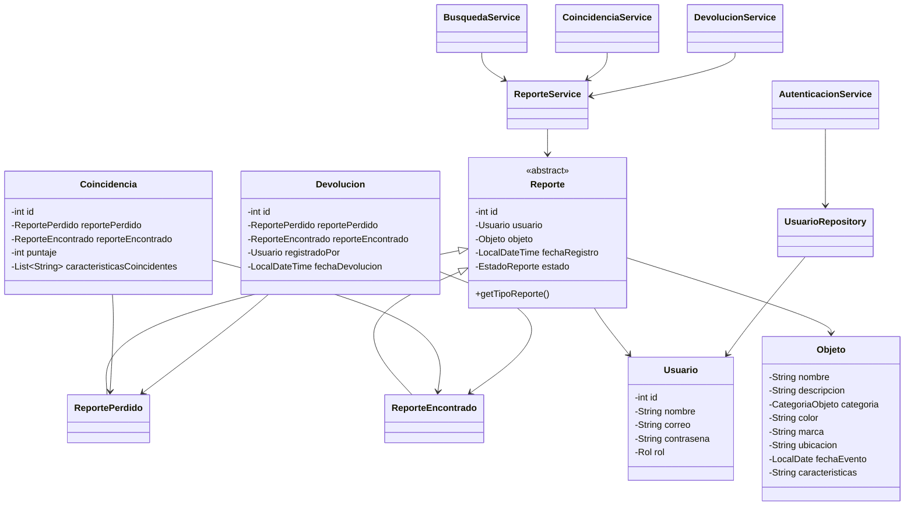

# Arquitectura de EncuentraU - Sprint 1

## Capas
1. **Modelos**: entidades del dominio.
2. **Repositorios**: almacenamiento temporal en memoria.
3. **Servicios**: reglas de negocio.
4. **Utilidades**: validaciones comunes.
5. **Main**: consola e integración.

## Relaciones principales
- `ReportePerdido` y `ReporteEncontrado` heredan de `Reporte`.
- `Reporte` contiene un `Usuario` y un `Objeto`.
- `Coincidencia` relaciona un reporte perdido con uno encontrado.
- `Devolucion` relaciona ambos reportes y registra al responsable.
- Los servicios usan `ReporteService` y `UsuarioRepository` por composición.

## Diagrama de clases

